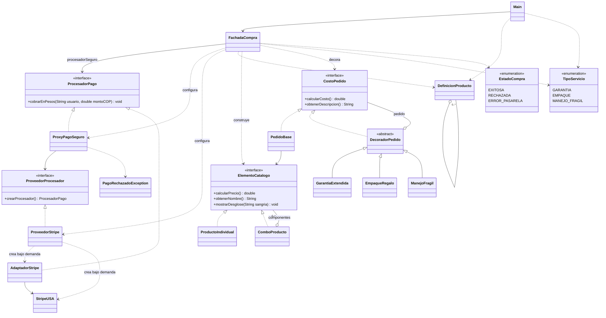

# Sustentación y verificación de ShopMaster

Esta guía relaciona el enunciado con el código y las pruebas. La demostración
consiste en ejecutar `Main` y explicar cómo colaboran los cinco patrones.

## Resultado de la validación integral

Validación realizada el 14 de octubre de 2026 con JDK 25.0.2 en Windows:

- Compilación UTF-8 con `-Xlint:all -Werror`, sin advertencias ni errores.
- Seis suites superadas: Composite, Decorator, Adapter, Proxy, Facade y Main.
- Ejecución independiente de `Main`: una compra exitosa y dos rechazadas.
- Comprobación de creación diferida con contadores en las pruebas de Proxy.
- Revisión de fuentes sin lectura por teclado ni banderas para combinar extras.
- Script probado tanto en modo de aplicación como en modo de pruebas.

La ejecución se verificó por consola. Falta realizar el ensayo oral y comprobar
la apertura y ejecución desde IntelliJ IDEA en la sesión del estudiante.

## Recorrido de diez minutos

| Tiempo | Demostración |
|---|---|
| 0:00–1:00 | Presentar ShopMaster, el flujo general y la entrada por fachada |
| 1:00–2:30 | Mostrar `ElementoCatalogo`, la hoja y la suma recursiva del combo |
| 2:30–4:00 | Explicar las envolturas, doble empaque y el orden de la garantía |
| 4:00–5:15 | Mostrar las firmas incompatibles y la división entre 4.000 |
| 5:15–6:45 | Mostrar validaciones antes de `crearProcesador()` y la auditoría |
| 6:45–7:45 | Recorrer `ejecutarCompraRapida()` y sus estados |
| 7:45–9:15 | Ejecutar `Main` y explicar los tres resultados |
| 9:15–10:00 | Relacionar SOLID con el diseño y mostrar las pruebas |

## Explicación de cada patrón

**Composite.** `ElementoCatalogo` es el componente, `ProductoIndividual` es la
hoja y `ComboProducto` es el compuesto. El combo contiene elementos del mismo
contrato. `calcularPrecio()` y `mostrarDesglose()` delegan recursivamente sin
preguntar si el hijo es producto o combo. Los `instanceof` se limitan a prevenir
ciclos al modificar el árbol; no deciden cómo cobrar.

**Decorator.** `CostoPedido` es el contrato común. `PedidoBase` conecta el catálogo
con ese contrato. `DecoradorPedido` contiene un pedido y las tres clases de
servicio agregan sus comportamientos. Dos empaques son dos envolturas; no existen
banderas de extras ni subclases por combinación. El cálculo parte del interior
hacia el exterior y la descripción conserva ese orden.

**Adapter.** `AdaptadorStripe` implementa `ProcesadorPago` y contiene `StripeUSA`.
Recibe usuario y COP, divide el importe entre 4.000 y llama a
`chargeInDollars(double amountUSD, String customerEmail, String merchantKey)`.
La clave llega por constructor y no aparece en la consola. La pasarela conserva
su firma externa; no implementa directamente el contrato local.

**Proxy.** `ProxyPagoSeguro` también implementa `ProcesadorPago`. Valida datos,
monto y usuario antes de llamar a `ProveedorProcesador.crearProcesador()`.
`ProveedorStripe` solo guarda la clave durante su construcción. El adaptador y
la pasarela se crean dentro de `crearProcesador()`. No se conserva un procesador
entre compras. La auditoría de aprobación se imprime después del cobro: si el
proveedor o la pasarela fallan, el error se propaga sin anunciar éxito.

**Facade.** `FachadaCompra` recibe definiciones de catálogo y una lista de
servicios, construye el Composite, aplica los decoradores y solicita el pago al
Proxy. El constructor que recibe una clave configura el flujo seguro usado por
`Main`. El constructor que recibe `ProcesadorPago` permite inyectar un Proxy
configurado o dependencias de prueba; el llamador debe suministrar ese control
cuando lo use. La fachada coordina; no calcula recargos ni convierte monedas.

## Relaciones UML

## Cálculos para defender

Caso 1: 800.000 + 200.000 + 25.000 + 15.000 = 1.040.000 COP.
Garantía: 104.000 COP. Empaque: 15.000 COP. Total: 1.159.000 COP.
Conversión: 1.159.000 / 4.000 = 289,75 USD.

Orden inverso: (1.040.000 + 15.000) × 1,10 = 1.160.500 COP.
La diferencia de 1.500 COP demuestra que la garantía afecta el valor actual.

Caso 2: 6.000.000 + 25.000 = 6.025.000 COP. El Proxy rechaza antes de crear
el procesador. Caso 3: 150.000 COP para el usuario exacto `BLOQUEADO`;
también se rechaza sin crear el procesador. En ambos se omiten conversión y cobro.

## Matriz de trazabilidad

Las suites son programas ejecutables en `pruebas`; todas se ejecutan con
el comando de pruebas de `README.md`. La columna de evidencia identifica qué comprobación
permite verificar cada requisito.

| ID | Requisito | Implementación | Evidencia |
|---|---|---|---|
| RF01 | Producto individual | `ProductoIndividual.calcularPrecio` | `PruebaComposite`: monitor de 800.000 |
| RF02 | Combos y subcombos | `ComboProducto.calcularPrecio` | `PruebaComposite`: kit 40.000 y combo 1.040.000 |
| RF03 | Desglose completo | `mostrarDesglose` | `PruebaComposite`: seis nodos y niveles de sangría |
| RF04 | Tratamiento uniforme | `ElementoCatalogo` | Variable del contrato y revisión del cálculo sin discriminar tipos |
| RF05 | Garantía del 10 % | `GarantiaExtendida` | `PruebaDecorator`: costo 1.144.000 |
| RF06 | Empaque de 15.000 | `EmpaqueRegalo` | `PruebaDecorator`: costo 1.055.000 |
| RF07 | Manejo frágil de 25.000 | `ManejoFragil` | `PruebaDecorator`: costo 1.065.000 |
| RF08 | Ningún extra, varios y repetición | Envolturas de `CostoPedido` | `PruebaDecorator`: sin extras, tres servicios y doble empaque |
| RF09 | Orden libre | Lista y capas de decoradores | `PruebaDecorator` y `PruebaFacade`: 1.159.000 frente a 1.160.500 |
| RF10 | Contrato local intacto | `ProcesadorPago` | Compilación y `PruebaAdapter` mediante la interfaz |
| RF11 | Firma externa incompatible | `StripeUSA` y `AdaptadorStripe` | `PruebaAdapter`: registra parámetros externos |
| RF12 | Conversión a USD | `convertirADolares` | `PruebaAdapter`: 289,75 y 290,125 sin redondeo previo |
| RF13 | Clave comercial | Constructor del adaptador | `PruebaAdapter`: clave recibida y ausente de salida |
| RF14 | Rechazo sobre 5 millones | `ProxyPagoSeguro` | `PruebaProxy`: 6.025.000 y 5.000.000,01 rechazados; 5.000.000 permitido |
| RF15 | Usuario exacto BLOQUEADO | `validarSolicitud` | `PruebaProxy`: mayúsculas rechazadas; minúsculas permitidas |
| RF16 | No crear ni invocar banco en rechazo | Proveedor diferido | `PruebaProxy`: contadores cero y rechazo después de compras válidas |
| RF17 | Auditoría aprobada | Proxy después de delegar | `PruebaProxy`: formato, orden y ausencia ante fallo o rechazo |
| RF18 | Una entrada de compra | `ejecutarCompraRapida` | `PruebaFacade`: catálogo, servicios y pago integrados |
| RF19 | Tres casos oficiales automáticos | `Main.main` | `PruebaMain`: importes, orden y estados |
| RF20 | Sin entrada por teclado | `Main` y subsistemas | Inspección de `src`: sin `Scanner`, `System.in` ni lectura interactiva |
| RT01 | Sin clases por combinación ni banderas de extras | Decoradores independientes | Revisión de `src/shopmaster/pedido` |
| RT02 | Java, composición, delegación y polimorfismo | Interfaces y clases de los cinco patrones | Compilación estricta y las seis suites |
| RT03 | Errores sin anunciar éxito | Proxy y estados de fachada | `PruebaProxy` y `PruebaFacade`: fallo simulado |
| RT04 | Español y excepciones del contrato externo | Fuentes Java | Revisión de nombres y mensajes |
| EV01 | Entrega funcional de código, 2 puntos | `src`, `Main` y pruebas | Ejecución de los tres escenarios y las seis suites |
| EV02 | Sustentación de diez minutos, 3 puntos | Esta guía y proyecto en IntelliJ | Requiere ensayo y defensa oral del estudiante |

## SOLID aplicado

| Principio | Decisión concreta |
|---|---|
| Responsabilidad única | Catálogo calcula precios; decoradores agregan extras; Proxy controla acceso; Adapter traduce pagos |
| Abierto y cerrado | Un nuevo decorador puede envolver `CostoPedido` sin cambiar `PedidoBase`; exponerlo en la lista exige ampliar la selección de servicios de la fachada |
| Sustitución | Productos y combos cumplen `ElementoCatalogo`; Proxy y adaptador cumplen `ProcesadorPago` |
| Segregación | Catálogo, costo del pedido y pago tienen contratos separados y pequeños |
| Inversión de dependencias | La fachada recibe `ProcesadorPago` y el Proxy recibe `ProveedorProcesador`; las pruebas inyectan sustitutos |

## Preguntas para ensayar

- ¿Por qué no sumar todos los extras siempre al precio base? La garantía afecta el
  valor acumulado y debe respetar la posición de su envoltura.
- ¿Por qué no crear `StripeUSA` en el constructor del Proxy? El rechazo exige
  evitar incluso esa instanciación. El proveedor aplaza la creación.
- ¿Cómo sabemos que no se llamó al banco? Los contadores de `PruebaProxy`
  permanecen en cero en los rechazos; no dependemos solo de la salida visible.
- ¿Qué diferencia Adapter de Proxy? Comparten contrato local, pero el primero
  traduce la operación y el segundo controla el acceso.
- ¿Qué hace `Main`? Define datos de prueba e invoca la fachada; no crea las
  clases Composite, los decoradores ni el banco.
- ¿Puede la compra fallar después de superar seguridad? Sí. Un error del banco
  produce `ERROR_PASARELA`, sin auditoría aprobada ni resultado exitoso.
- ¿Qué límites tiene el ejercicio? Pasarela simulada, usuario sin correo real,
  importes `double`, sin persistencia ni conexión bancaria. El formato monetario
  de consola no implica redondear el importe enviado a la pasarela.

## Preparación de la demostración

- Abrir el proyecto en IntelliJ y configurar JDK, raíz de fuentes y UTF-8 según
  `README.md`.
- Ejecutar las pruebas antes de compartir pantalla.
- Mantener abiertos `Main`, `ComboProducto`, `GarantiaExtendida`,
  `AdaptadorStripe`, `ProxyPagoSeguro`, `ProveedorStripe` y `FachadaCompra`.
- Explicar las responsabilidades y seguir una compra completa por esas clases.
- Mostrar los dos rechazos y los contadores de sus pruebas.
- Ensayar el recorrido con cronómetro. La preparación documental no sustituye
  la sustentación oral ni verifica por sí sola la configuración del IDE.
